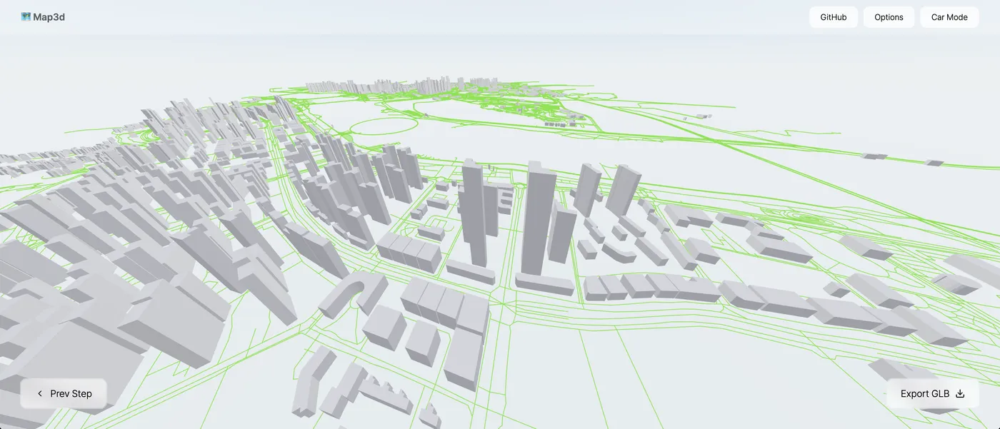

<p align='center'>
<h1 align='center'>🗺️ map3d</h1>
<p align='center'>Generate real-world 3D maps & 3D-printable GPX models / 生成真實世界 3D 地圖與可列印 GPX 模型</p>
</p>



**工作進度（2026-11-04）**：[已完成／部分完成／尚未完成與驗證記錄](docs/STATUS.md)。本輪補齊建築／GPX的完整模型取景、復位／俯視／縮放44px鍵盤控制，GPX按完整模型會收合遮擋設定卡但保留參數；1786 program、完整521 dev＋120 production CSP、12對改視角前後逐byte相同STL與17fixtures／9negative／63真DXF全過（[真源碼、操作畫面與完整證據](docs/model-camera-controls.md)）；先前修正雙坡／單坡 `roof:levels=0` 被當缺值而憑空套用angle／預設屋頂，保留APP優先序、總高／架空／中庭及兩場景DXF；1716 program、491 dev＋90 production CSP與17fixtures／9negative／63真DXF全過（[來源、before失敗與完整實測](docs/zero-roof-levels.md)）；先前新增合法矩形四坡 `roof:angle` 的有限屋脊距離高度推導，保留兩場景／DXF／高度優先序／共線節點與雙語fallback；1622 program、完整479 dev＋87 production CSP與15fixtures／9negative／63真DXF通過（[源碼、失敗與最終focused證據、CI分階段與限制](docs/hipped-angle.md)）；先前完成搜尋座標／bbox／有界回應完整性及清除／編輯／模式／頁面取消，1499 program／473 dev＋84 production CSP、63真DXF獨立驗證通過（[固定官方源碼、實測與公用服務上線限制](docs/place-search-safety.md)）；先前新增3D場景內建築／道路／地形逐層重試、partial區塊狀態與44px可達控制；1427 program／455 dev＋66 production CSP、63真DXF獨立驗證通過（[源碼與實測](docs/scene-data-recovery.md)）；先前修復定向DEM無效高程／不完整格網被當0米成功的路徑，整批備援、雙失敗明示平坦參考與Retry已通過1400 program／437 dev＋48 production CSP、57真DXF獨立驗證（[來源與完整證據](docs/terrain-elevation-integrity.md)）；先前修正DXF原始owner／handle引用並加獨立CAD gate（[13項patch契約、14fixtures／9負向控制／51真下載驗證](docs/cad-conformance.md)）；先前補上四坡直邊共線節點保留、完整邊長選軸及對應底蓋分段（[來源與1342／422＋45完整驗證](docs/hipped-collinear-nodes.md)）；先前補上四坡屋頂明確屋脊方向及優先序（[來源、限制與1260／404＋42完整驗證](docs/hipped-ridge-direction.md)）；先前新增來源導向的矩形四坡屋頂、兩場景／DXF與獨立fallback提示（[來源、投影限制與1172／386＋39完整驗證](docs/hipped-roofs.md)）；先前修復窄螢幕比例尺／多行來源註記重疊，並依實際較舊工作區補回有界GeometryCollection與地圖下方提示（[源碼、before／after與全新完整驗證](docs/map-footer-layout.md)）；保留GPX匯入／數值／海拔完整性與非同步取消（[限制及實測](docs/gpx-import-safety.md)），保留可收合、鍵盤可用的GPX設定卡與短螢幕修正（[版面驗證](docs/gpx-model-layout.md)），保留production CSP與built-dist阻擋／下載驗證（[政策與例外](docs/content-security-policy.md)），保留先前有界金字塔／架空底部／五格式可見性／草稿／多分頁／版面修正；不代表已部署或已完成全部 GIS／LoD2／實機驗收。

> **公開搜尋上線條件未驗收：** [Nominatim 官方政策](https://operations.osmfoundation.org/policies/nominatim/) 的最多1request/second是全網站／APP合計；現有每頁queue不控制所有使用者總量。另需開發者知情採用與免bundle更新的服務切換等條件。未宣稱公用服務已獲授權或符合所有上線要求，詳見[政策blocker](docs/place-search-safety.md#重要公用-nominatim-尚不是公開上線核准)。

## About The Project

A 3D mapping tool built with [React-Three-Fiber](https://github.com/pmndrs/react-three-fiber), merging the features of the original [cartesiancs/map3d](https://github.com/cartesiancs/map3d) and my earlier `building3d` project into one:

**Mode 1 — Map → 3D Buildings（地圖 → 3D 建築）**

- Select an area on the map (OpenStreetMap / Leaflet)
- Fetch buildings & roads from the Overpass API
- Export only enabled `Object3D` hierarchies consistently across GLB/glTF/OBJ/STL/DXF; terrain-off keeps flat ground, not a removed surface ([scope/tests](docs/export-visibility.md))
- Render `roof:shape=hipped` for four-true-corner hole-free projected rectangles (including bounded collinear boundary nodes) with roof height/levels or validated roof:angle-derived finite-ridge rise; source-derived ridge inset, n+2 roof triangles retaining all n boundary nodes, explicit roof:ridge:direction and bilingual flat-fallback counts ([scope/tests](docs/hipped-roofs.md))
- Render `roof:shape=pyramidal` as centroid-to-edge faces for convex hole-free footprints with tagged roof height/levels; unsupported cases remain explicitly reported hole-aware flat fallbacks ([scope/tests](docs/pyramidal-roofs.md))
- Preserve validated `min_height` / `building:min_level` undercrofts without raising roof-inclusive total heights; reject invalid occupied intervals visibly ([scope/tests](docs/building-elevation.md))
- Render real-world 3D buildings (explicit OSM `height` wins over storey estimates); `roof:shape=gabled` adds sloping roofs and filled gable ends; `skillion` uses one downhill plane with explicit direction (missing direction is reported and shown flat)
- Closed OSM multipolygon courtyards, islands and their own holes survive both scenes and DXF when roles alternate correctly; incomplete/unsupported footprints show a skipped-object warning, not a filled-outer fallback ([supported subset](docs/building-islands.md)).
- Roads rendered as solid meshes with widths based on highway type
- Click a building to see its OSM info (name, height, address, translations...)
- A base plate is generated underneath so exports are 3D-printable
- Place / address search on the map (OpenStreetMap Nominatim) — a thumb-sized bar on a phone: 16 px field (no iOS zoom-on-focus), 44 px targets, results you can scroll with one finger
- Automatic fallback to mirror Overpass servers when the main one is busy (429 / 5xx / timeout) or unreachable; a mirror that fails is put on a cooldown instead of being paid for again on every query

### Where the map data comes from (and what is *not* limited)

Buildings, roads, terrain, tiles and place search are all fetched **by the browser, straight from the public services** (Overpass, Open-Meteo / OpenTopoData, Lands Department, Nominatim). Vercel only serves the static `dist/` bundle — no request ever carries OSM data through it, so there is **no request-body size, response size or memory budget imposed by the host** to design around.

For the main scene fetch, limits come from public services and browser/device safety, not the static host. The optional reference-GeoJSON loader has a separate 2 MB safety budget; it is not an Overpass truncation limit:

- **A big selection is fetched in pieces.** One Overpass query over a large box is what used to make a city fail to load (the mirror runs out of time or memory and the whole response is lost). The box is now cut into a grid of ~1.2 km cells — see `planCells` in `src/utils/sceneData.ts` — and the cells are fetched with a small amount of concurrency. Each cell is published as it lands, so the city fills in while the rest is still loading and one failed cell never cancels the others. The map's size hint (`ok` / `slow` / `big`) is about **time, not an automatic refusal**; provider incompleteness and geometry rejection are reported separately.
- **Nothing is silently truncated.** The 3D builders used to stop at 6,000 buildings / 6,000 roads, which quietly deleted most of a real city. That is gone; the overall draw-count cap is a 40,000 safety valve that logs a warning and shows `drawn / fetched` in the scene panel rather than pretending the data is complete. Building topology validation additionally rejects unsupported/invalid footprints or those exceeding 2,048 source coordinate entries / 65 assembled rings, with a visible object count; it never truncates a ring or fills a missing courtyard.
- A cell query that comes back flagged incomplete (server-side timeout) is **used as-is** instead of being thrown away.

**Mode 2 — GPX → 3D Print Model（GPX → 3D 列印模型）**

- Import a hiking / cycling GPX track (drag & drop)
- Generates a solid 3D model: base plate + track ribbon following the elevation profile, with start/end markers
- Adjustable elevation exaggeration, track width and base thickness
- Track statistics: distance, elevation gain, elevation range
- Track without elevation? One click fills it in from terrain data (Open-Meteo / Copernicus DEM, fallback OpenTopoData SRTM)
- One-click STL export, ready for slicing & printing

**Mode 3 — 3D City Orienteering（3D 城市定向 · 手機優先）**

- Three steps like the building mode: ① circle the course area on the map → ② get the 3D scene (buildings, roads and terrain load with a visible status and per-item retry) → ③ place the controls in the 3D city
- Checkpoints are drawn as the orienteering symbols — △ start, ○ control (with its number), ◎ finish — standing on the terrain, with the course line between them
- Place by tapping the ground, drag a marker to move it, tap it to delete; each control carries a code, name, clue and score
- Live leg information in the HM20C grid-reference style used on paper: `50Q KK 0834 6805`, 6-figure `KK 083 680`, planar leg distance and grid **and** magnetic bearing (3.1°W)
- Ground is textured with the Lands Department Map API (iB20000 / HM20C-series basemap, aerial photography, or the OpenTopoMap countryside layer) draped over real terrain from Copernicus DEM / SRTM
- Retry unavailable buildings, roads or terrain directly in 3D Scene settings; partial cell failures are reported, loading blocks duplicate requests, and course/private notes/other layers remain intact ([scope/tests](docs/scene-data-recovery.md)).
- DEM responses require every requested cell to have valid numeric elevation; a bad primary grid triggers whole-grid backup. Both fail → visible retry/unmeasured-flat warning, never fabricated successful 0 m ([source/tests](docs/terrain-elevation-integrity.md)). True zero/negative elevations remain valid.
- A 1 km UTM grid traced along the hills, plus optional 10 m contours and canvas hillshade (azimuth 315°, altitude 45°); these interpolate the existing coarse DEM, not survey-grade detail
- Courses import and export as JSON — the same shape the Scout System / HKMAP planner writes, so a course drafted on the desktop imports straight into the phone
- One-tap **GLB / STL export** of the scene (ground, city, course line and markers) for a 3D print or for sharing
- **Share with players（分享給玩家）** — one tap builds a `#play=…` link that carries the area and the whole course (compressed into the URL, nothing uploaded). Players open it and land straight in the 3D city in a read-only *player view*: they can orbit, tap a control to read its code / clue / grid reference, and export the GLB, but nothing can be moved or edited, and the link never overwrites a course saved on their own phone

**Mobile-first UI（手機優先）**

The whole app is built to be driven with one thumb: 44 px minimum touch targets, `100dvh` layout with safe-area insets for notches and home indicators, panels that slide up as a draggable bottom sheet on phones and become side panels on a wide screen, and a labelled camera palette (fit / top / tilt / zoom) opened from the camera button, beside the usual one-finger orbit and two-finger pinch. Expanded sheets reserve room for controls/credits; short landscape uses a scrollable sidebar and a canvas that excludes it. Native popovers have an explicit modeless fallback. See [responsive-scene evidence and device limits](docs/responsive-scene.md).

**Export formats:** GLB / glTF / OBJ / STL / DXF (R2010, 3DFACE)

**Bilingual UI:** English / 繁體中文 (toggle in the top bar)

> [!IMPORTANT]
> 📢 <strong>This project cannot guarantee the accuracy of the data.</strong> Map data comes from OpenStreetMap; some building heights may be missing or incorrect. In the orienteering mode the 3D ground is drawn from the Lands Department Map API and the scene keeps the required credit *Map from Lands Department · Aerial Photograph from Lands Department* on screen; the underlying data is used under the [Lands Department Map API terms](https://portal.csdi.gov.hk/csdi-webpage/doc/TNC). Terrain heights come from Copernicus DEM / SRTM and are indicative only — always check the official map and the ground before an event.

## v0.1.0 · GIS and reliability

- The selection map now has a **GIS data sources** panel: 10 dataset entries across 7 providers, with browser-direct XYZ/WMS/GeoJSON loading and clear source terms, loading state and retry. These are **2D references only**, not new DEM/building/export inputs.
- A temporary local GeoJSON importer now displays clipped/converted WGS84 vectors without uploading them (2 MB / 10k features / 150k positions). Failure keeps the previous layer; only an explicit zoom action moves the map. See [preparation and privacy guide](docs/local-data-and-sharing.md).
- WorldPop and HydroRIVERS are download/preprocessing references, **not working web layers**. The supplied WorldPop URL is a large TIFF/ZIP directory, not WMS. No bulk dataset is shipped or automatically downloaded. See [source evidence and limits](docs/data-sources.md).
- Export progress/errors are visible and duplicate taps are blocked. GPX miniature millimetres are converted correctly for metre-based DXF. The front screen no longer starts a hidden 3D scene or downloads optional CDN HDR lighting.
- Install metadata and 9 versioned PNG/ICO assets are present. This does **not** provide offline map downloads or a service worker.
- Player sharing now responds to same-page fragment changes and fresh links, excludes planner-only notes, and restores the private course/area on exit. **Course JSON backups retain notes; old shared URLs may already contain them.** Import/share size validation and full UI flow tests are included.
- [Short user guide](docs/USER_GUIDE.md) · [scope](SCOPE.md) · [implementation audit / known gaps](docs/APP_AUDIT.md) · [changes](CHANGELOG.md).

## Development

Node 22.13+ is recommended (matching CI; tested on 22.22.3). The ESLint 10 toolchain requires `^20.19.0 || ^22.13.0 || >=24`. After `npm ci`, `npm run audit:deps` checks production advisories and high/critical development advisories; the supported ESLint/TypeScript-ESLint/plugin migration is complete, but 12 development-only moderate minimatch reports remain visible because current upstream ranges still select v10 rather than patched 11.0.1. See [security snapshot and test reproduction](docs/dependency-security.md).

```bash
npm install
npm run dev
```

| Command | What it does |
| --- | --- |
| `npm run dev` | Vite dev server |
| `npm run build` | Type-check + production build + bundle budget check (`dist/`) |
| `npm run lint` | ESLint 10, full React Hooks recommended rules |
| `npm run verify:lint` | 13 positive/negative checks of the actual flat lint config; also in `check` |
| `npm run guard` | Repository hygiene check (junk / oversized / unused files, deps, Vercel config) |
| `npm run verify` | Runs the orienteering verification harness (geodesy vs PROJ, course maths, tile maths, terrain sampling, geometry builders) |
| `npm run verify:release` | Version / icon dimensions, format, budget, manifest and metadata checks |
| `npm run verify:ui` | Chromium checks at 390/768/1440; existing dev server required, external data mocked |
| `npm run verify:ui:isolated` | After build + Chromium installation: 455 dev checks, then 66 built-production CSP checks; servers cleaned up |
| `npm run verify:csp` | After build: isolated production CSP/real-download/native-blocking browser gate at 390/768/1440 |
| `npm run audit:deps` | Online gate: no production advisories; no high/critical in the full dependency graph |
| `npm run verify:dxf-writer` | Verify exact dxf-writer ownership patch plus 13 install/drift contracts; included in check |
| `npm run verify:cad` | Test-only Python/ezdxf raw-reference, audit and roundtrip gate; install pinned requirements first ([instructions](docs/cad-conformance.md)) |
| `npm run check` | `verify:dxf-writer` + `lint` + `guard` + `verify` + `verify:release` + `build` — run before every push (CI runs it too) |
| `npm run clean` | Remove build output, caches and untracked junk (`-- --all` also removes `node_modules`, `-- --dry-run` only lists) |

## Deployment (Vercel) & slimming guards / 部署與瘦身防呆

> **改版前先讀 [`docs/SLIM.md`](./docs/SLIM.md)（瘦身防呆原則）** — 哪些東西不能提交、各項容量預算、以及 Vercel Dashboard 要做的保留期設定。`npm run check` 會強制執行大部分條款。

- **`vercel.json`** pins the Vite build (`npm run build` → `dist/`) — only `dist/` is served. Hashed files in `/assets/` are cached for a year (`immutable`), and vendor code (React / three.js / Leaflet) is split into separate chunks, so a deploy that only changes app code makes returning visitors re-download ~50 kB instead of the whole ~1.4 MB bundle.
- **`.vercelignore`** keeps `.git`, `node_modules`, local builds, logs, backups (`*.bak *.tmp *.old`…), test `uploads/`, docs and screenshots out of Vercel.
- **Ignored Build Step** (`scripts/vercel-ignore-build.mjs`): pushes that only touch docs (`*.md`, `docs/`, `.github/`) don't trigger a new build, and automation branches (`arena/*`, `dependabot/*`, `renovate/*`…) get no preview deployments (`PREVIEW_DEPLOYS=1` re-enables them). Anything uncertain always builds; set `FORCE_BUILD=1` to force. Requires *Automatically expose System Environment Variables* (on by default).
- **`scripts/slim-guard.mjs`** (防呆) fails `npm run check`, CI and the Vercel build when:
  - backup / temp / log files, `dist/`, `node_modules/` or `uploads/` are committed
  - heavy media / design sources / archives / 3D models are committed
  - a file is > 1 MB, an image is > 300 kB, the repo is > 3 MB, a `public/` asset is > 500 kB or not referenced anywhere
  - a `src/` file is not reachable from `src/main.tsx` (dead code)
  - build-only tools (Vite, TypeScript, `@types/*`, ESLint, Tailwind…) land in `dependencies`
  - `package-lock.json` is out of sync or carries orphan entries
  - `.vercelignore` is missing required entries or would hide build inputs; `vercel.json` points to the wrong output
  - `dist/` exceeds its size budget, or ships source maps / `.d.ts` / junk files

  Budgets live at the top of the script. Emergency escape hatch: `SLIM_GUARD=warn`.

## Credits

- Original map3d project by [cartesiancs](https://github.com/cartesiancs/map3d) (MIT License), created by Hyeong Jun Huh [(GitHub)](https://github.com/DipokalLab)
- Multi-format export & solid-mesh road ideas merged from my `building3d` project
- Map data © [OpenStreetMap](https://www.openstreetmap.org/copyright) contributors (Overpass API, Nominatim); elevation data from [Open-Meteo](https://open-meteo.com/) (Copernicus DEM GLO-90) and [OpenTopoData](https://www.opentopodata.org/) (SRTM)
- Orienteering mode built on the data model and conventions of [Scout System · 香港城市定向地圖 (HKMAP)](https://github.com/playerkousas-rgb/HKMAP): the △ ○ ◎ control symbols, HM20C-style UTM grid references (`KK 0794 6642`), the 3.1°W magnetic declination and a course-JSON layout that round-trips between the two apps
- Base map tiles © Hong Kong Special Administrative Region Government, Lands Department (Map API, iB20000-series); the countryside layer © [OpenTopoMap](https://opentopomap.org/) (CC-BY-SA)

## License

MIT License

---

**Copyright © Scout System**
