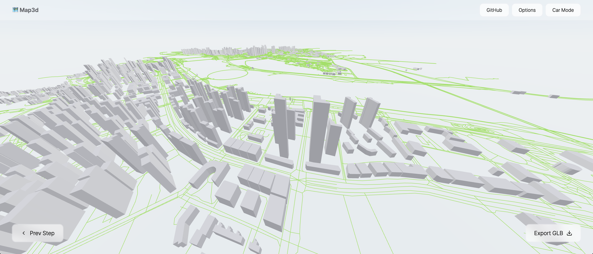

<p align='center'>
<h1 align='center'>🗺️ map3d</h1>
<p align='center'>Generate real-world 3D maps & 3D-printable GPX models / 生成真實世界 3D 地圖與可列印 GPX 模型</p>
</p>



## About The Project

A 3D mapping tool built with [React-Three-Fiber](https://github.com/pmndrs/react-three-fiber), merging the features of the original [cartesiancs/map3d](https://github.com/cartesiancs/map3d) and my earlier `building3d` project into one:

**Mode 1 — Map → 3D Buildings（地圖 → 3D 建築）**

- Select an area on the map (OpenStreetMap / Leaflet)
- Fetch buildings & roads from the Overpass API
- Render real-world 3D buildings (height from OSM `height` / `building:levels` tags)
- Roads rendered as solid meshes with widths based on highway type
- Click a building to see its OSM info (name, height, address, translations...)
- A base plate is generated underneath so exports are 3D-printable
- Place / address search on the map (OpenStreetMap Nominatim)
- Automatic fallback to mirror Overpass servers when the main one is busy (429 / 5xx / timeout)

**Mode 2 — GPX → 3D Print Model（GPX → 3D 列印模型）**

- Import a hiking / cycling GPX track (drag & drop)
- Generates a solid 3D model: base plate + track ribbon following the elevation profile, with start/end markers
- Adjustable elevation exaggeration, track width and base thickness
- Track statistics: distance, elevation gain, elevation range
- Track without elevation? One click fills it in from terrain data (Open-Meteo / Copernicus DEM, fallback OpenTopoData SRTM)
- One-click STL export, ready for slicing & printing

**Export formats:** GLB / glTF / OBJ / STL

**Bilingual UI:** English / 繁體中文 (toggle in the top bar)

> [!IMPORTANT]
> 📢 <strong>This project cannot guarantee the accuracy of the data.</strong> Map data comes from OpenStreetMap; some building heights may be missing or incorrect.

## Development

```bash
npm install
npm run dev
```

| Command | What it does |
| --- | --- |
| `npm run dev` | Vite dev server |
| `npm run build` | Type-check + production build + bundle budget check (`dist/`) |
| `npm run lint` | ESLint |
| `npm run guard` | Repository hygiene check (junk / oversized / unused files, deps, Vercel config) |
| `npm run check` | `lint` + `guard` + `build` — run before every push (CI runs it too) |
| `npm run clean` | Remove build output, caches and untracked junk (`-- --all` also removes `node_modules`, `-- --dry-run` only lists) |

## Deployment (Vercel) & slimming guards / 部署與瘦身防呆

- **`vercel.json`** pins the Vite build (`npm run build` → `dist/`) — only `dist/` is served. Hashed files in `/assets/` are cached for a year (`immutable`), and vendor code (React / three.js / Leaflet) is split into separate chunks, so a deploy that only changes app code makes returning visitors re-download ~50 kB instead of the whole ~1.4 MB bundle.
- **`.vercelignore`** keeps `.git`, `node_modules`, local builds, logs, backups (`*.bak *.tmp *.old`…), test `uploads/`, docs and screenshots out of Vercel.
- **Ignored Build Step** (`scripts/vercel-ignore-build.mjs`): pushes that only touch docs (`*.md`, `docs/`, `.github/`) don't trigger a new build. Anything uncertain always builds; set `FORCE_BUILD=1` to force. Requires *Automatically expose System Environment Variables* (on by default).
- **`scripts/slim-guard.mjs`** (防呆) fails `npm run check`, CI and the Vercel build when:
  - backup / temp / log files, `dist/`, `node_modules/` or `uploads/` are committed
  - a file is > 1 MB, a `public/` asset is > 500 kB or not referenced anywhere
  - build-only tools (Vite, TypeScript, `@types/*`, ESLint, Tailwind…) land in `dependencies`
  - `package-lock.json` is out of sync or carries orphan entries
  - `.vercelignore` is missing required entries or would hide build inputs; `vercel.json` points to the wrong output
  - `dist/` exceeds its size budget, or ships source maps / `.d.ts` / junk files

  Budgets live at the top of the script. Emergency escape hatch: `SLIM_GUARD=warn`.

## Credits

- Original map3d project by [cartesiancs](https://github.com/cartesiancs/map3d) (MIT License), created by Hyeong Jun Huh [(GitHub)](https://github.com/DipokalLab)
- Multi-format export & solid-mesh road ideas merged from my `building3d` project
- Map data © [OpenStreetMap](https://www.openstreetmap.org/copyright) contributors (Overpass API, Nominatim); elevation data from [Open-Meteo](https://open-meteo.com/) (Copernicus DEM GLO-90) and [OpenTopoData](https://www.opentopodata.org/) (SRTM)

## License

MIT License

---

**Copyright © Scout System**
